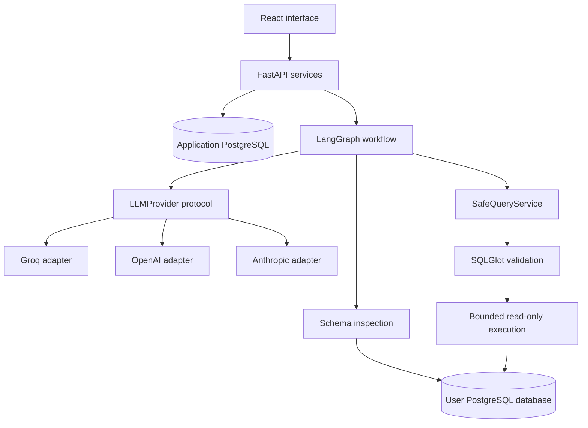

# InsightForge

**Turn PostgreSQL data into interactive dashboards through conversation.**

[](https://github.com/Abderrafea/InsightForge/actions/workflows/verify.yml)

[Try the live application](https://insightforge.fastapicloud.dev/) · [Deployment guide](deploy/FASTAPI_CLOUD.md) · [AI providers and models](deploy/AI_PROVIDERS.md)

InsightForge connects to a PostgreSQL database, discovers its schema, and uses an AI model to build a dashboard from your request. Continue the conversation to change charts, add metrics, or adjust the analysis. Every generated query passes through a read-only SQL validation and execution layer.

Bring your own **Groq, OpenAI, or Anthropic API key**. Choose a suggested model or enter a compatible model ID available to your account.

## What you can do

- **Create dashboards from natural language.** Ask for revenue trends, regional comparisons, top products, or other metrics supported by your database.
- **Refine an existing dashboard.** Change chart types, add or remove widgets, update filters, and request a different grouping. UI-only edits preserve existing queries; data changes regenerate the affected queries.
- **Explore PostgreSQL schemas.** Discover tables, columns, primary keys, and foreign keys, with cached metadata and explicit refresh.
- **View KPIs, charts, and tables.** The React interface renders validated dashboard configurations and refreshes their query data.
- **Keep conversations organized.** Create, rename, select, and delete analysis sessions, each with its own chat history and database connection.
- **Use isolated visitor workspaces.** Each browser session has its own saved connections, conversations, and dashboards, with an option to erase them.
- **Switch AI providers through one interface.** Groq, OpenAI, and Anthropic adapters implement the same provider protocol and structured-output contracts.

For example:

> Build a sales dashboard with total revenue, monthly revenue, and the five best-selling products.
>
> Change the monthly revenue chart to weekly and keep the other widgets.
>
> Turn the product chart into a horizontal bar chart.

The available analyses depend on the tables and columns in the connected database.

## How it works

1. Select an AI provider and model, enter your key, and review the data-sharing consent.
2. Connect a PostgreSQL database using a dedicated read-only account.
3. Create a session and describe the dashboard you want.
4. InsightForge inspects the schema, plans the widgets, generates SQL, validates it, and executes bounded read queries.
5. Review the dashboard and request changes in the chat. Successful changes create immutable dashboard versions.

The live application uses FastAPI Cloud for the application and Neon for its application database. Your analysis database is a separate connection that you provide.

## Privacy and access

**Public mode uses browser-session isolation, without account registration.** A signed, HttpOnly cookie identifies the workspace. It is Secure in production and expires after eight hours by default. This does not provide permanent accounts, password recovery, or access across devices.

- Your AI key stays in page memory. It is sent to the backend over HTTPS for agent requests, then used by the selected provider adapter. It is not stored in local storage, cookies, or the application database. Reloading requires entering it again.
- Database passwords are encrypted at rest so later queries and dashboard refreshes can reconnect.
- Prompts, schema metadata, and any configured query-result samples are shared with the selected AI provider. The hosted entry point defaults to zero sampled result rows.
- **Erase my private session** removes the visitor's saved connections, messages, dashboards, and query history. Expired workspaces are also cleaned up; execution depends on the deployment being awake. Existing backups follow their own retention policy.

Public database connections require a publicly reachable PostgreSQL host, port `5432` or `6543`, and `verify-full` TLS. Private networks, loopback addresses, and mixed public/private DNS responses are rejected. Use a database account you are authorized to access with read-only privileges.

See [public visitor mode](deploy/PUBLIC_DEMO.md) for access controls, quotas, and cleanup details.

## Run locally with Docker

Requirements: Git and Docker with Docker Compose v2.

```sh
git clone https://github.com/Abderrafea/InsightForge.git
cd InsightForge
docker compose up --build
```

Open [http://localhost:5173](http://localhost:5173). The default configuration uses the public visitor flow: enter your own AI key in the browser and connect a public PostgreSQL database with verified TLS.

The development stack binds its published ports to loopback:

- `5173`: React application and API proxy.
- `8001`: FastAPI, with local [interactive API documentation](http://localhost:8001/docs).
- `5435`: application PostgreSQL database.
- `5434`: bundled ecommerce demo database.

Check API liveness with:

```sh
curl http://localhost:8001/health
```

### Use the bundled ecommerce database

The bundled database is private to the Docker network, so use **local owner mode** to analyze it. Create or update a `.env` file at the repository root with your own values:

```dotenv
ACCESS_MODE=owner
AI_PROVIDER=groq
AI_MODEL=<a compatible model available to your account>
GROQ_API_KEY=<your API key>
```

For OpenAI or Anthropic, change `AI_PROVIDER` to `openai` or `anthropic` and set `OPENAI_API_KEY` or `ANTHROPIC_API_KEY` respectively. Keep `.env` out of Git.

Restart the stack with `docker compose up --build`, then enter these **local development credentials** in the connection dialog:

```text
Host:      demo-db
Port:      5432
Database:  demo_ecommerce
Username:  dashboard_reader
Password:  dashboard_reader_dev
SSL mode:  disable
```

For a backend running directly on your host, use `localhost:5434` instead. These credentials and the Compose encryption key are development examples. Owner mode in development is intended for local use; the production owner deployment uses an authenticated HTTPS gateway.

The application and demo databases use Docker volumes. Stop the stack with `docker compose down` to retain them.

## Architecture



The **application database** stores visitor identities, sessions, messages, encrypted connection metadata, schema caches, dashboard configurations, versions, and audit metadata. The **analysis database** is the user's PostgreSQL database, accessed through short-lived connections.

The AI workflow handles intent, planning, SQL generation, bounded SQL repair, and dashboard construction. Schema inspection, query policy, execution, and persistence remain application-controlled. Provider adapters hide SDK differences from the workflow; database passwords are not passed to the model.

The backend uses FastAPI, SQLAlchemy, psycopg, Alembic, LangGraph, Pydantic, and SQLGlot. The frontend uses React, TypeScript, Vite, Tailwind CSS, and Recharts.

## Query safety

Every analytical query, including AI-generated SQL, passes through the same `SafeQueryService`:

- PostgreSQL AST parsing with single-statement, read-query enforcement and CTE inspection.
- Schema-aware table validation, conservative column validation, and blocked system schemas and dangerous functions.
- Database-enforced read-only transactions and statement timeouts.
- Limits on SQL length, joins, returned rows, and serialized result size.
- Validated DNS addresses pinned during connection, with hostname verification preserved for TLS and bounded retries across checked addresses.
- Sanitized errors and metadata-only query history; query result datasets are not saved as query-history records.

These controls complement a restricted database role. They do not replace database permissions or make every installation-specific SQL function safe.

## Development and verification

For backend development, use Python 3.12 or 3.13, install the development dependencies, and configure a local environment from [backend/.env.example](backend/.env.example):

```sh
cd backend
python -m venv .venv
# Activate the virtual environment for your shell.
pip install -e ".[dev]"
alembic upgrade head
uvicorn app.main:app --reload
```

Use `uvicorn app.main:app` for local development. The configured `app.cloud:app` entry point is for a hosted production environment. On Windows, psycopg asynchronous connections require a selector event loop; Docker provides the Linux path for the complete test suite and migrations.

For frontend development against an API on port `8000`:

```sh
cd frontend
npm ci
npm run dev
```

Run backend unit, API, and PostgreSQL integration tests from the repository root:

```sh
docker compose --profile test run --build --rm tests
docker compose --profile test run --rm tests ruff check --no-cache app tests
```

Run frontend checks:

```sh
cd frontend
npm ci
npm test
npm run build
npm audit --audit-level=low
```

GitHub Actions runs backend PostgreSQL tests and lint, plus frontend tests, the production build, and dependency auditing. Tests cover SQL restrictions, visitor isolation, encrypted credentials, provider adapters, dashboard generation and editing, version persistence, production access checks, and deployment configuration.

Provider calls are mocked in the default suite. The optional live Groq integration test requires your own configured key and model:

```sh
cd backend
RUN_GROQ_INTEGRATION_TESTS=1 pytest -q tests/integration/test_groq_provider.py
```

A separate smoke test of the hosted application has exercised schema inspection, read-only SQL, write-query rejection, live Groq generation of two widgets, and dashboard data retrieval using synthetic sales data. OpenAI and Anthropic adapters have been tested with mocks; live calls to those providers require their own keys.

## Deployment and API guides

- [FastAPI Cloud and Neon](deploy/FASTAPI_CLOUD.md): current hosted setup, frontend packaging, secrets, migrations, and release checks.
- [Public visitor mode](deploy/PUBLIC_DEMO.md): visitor-supplied keys, browser-session isolation, erasure, and limits.
- [AI providers and models](deploy/AI_PROVIDERS.md): adapter behavior, suggested models, and custom model IDs.
- [Docker server deployment](deploy/README.md): HTTPS gateway, owner access, secrets, backups, and restore.
- [Render and Neon](deploy/RENDER.md): alternative single-container deployment configuration. The current live application is hosted on FastAPI Cloud.

For API clients, public mode starts with `POST /api/access` and the returned visitor cookie. State-changing requests require `X-Requested-With: InsightForge`. Agent requests additionally carry `Authorization: Bearer <key>`, `X-AI-Provider`, and `X-AI-Model`. The browser client handles these headers.

The main flow is connection test/save, schema inspection, session creation, connection attachment, and `POST /api/sessions/{id}/agent/messages`. Retrieve the rendered dashboard data through `GET /api/sessions/{id}/dashboard`. `DELETE /api/access` erases the visitor workspace. Interactive API documentation is enabled in development and disabled in production.

## Current limits

- PostgreSQL is the supported analysis database.
- Model compatibility depends on structured-output support and access granted to the supplied key. Suggested models are not an exhaustive catalog; provider billing belongs to the key owner's account.
- Public mode provides temporary browser workspaces rather than permanent user accounts.
- Provider calls use request/response execution; streaming, cancellation, and background agent runs are not implemented.
- Dashboard version snapshots are stored, but version browsing and rollback controls are not exposed in the UI.
- Column validation is deliberately conservative for complex SQL scopes; PostgreSQL still validates queries at execution time.
- Hosting can scale to zero, and free-plan quotas can affect availability. Independent scheduled off-site backups must be configured separately.
